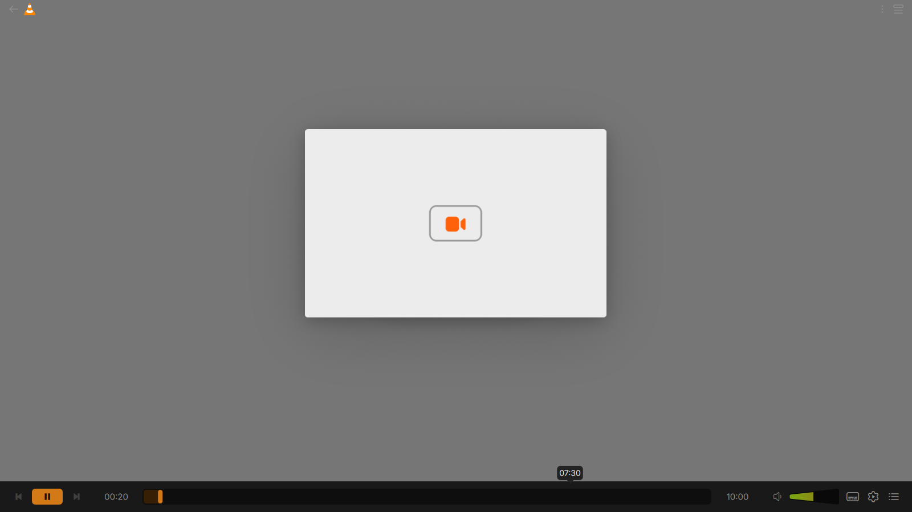
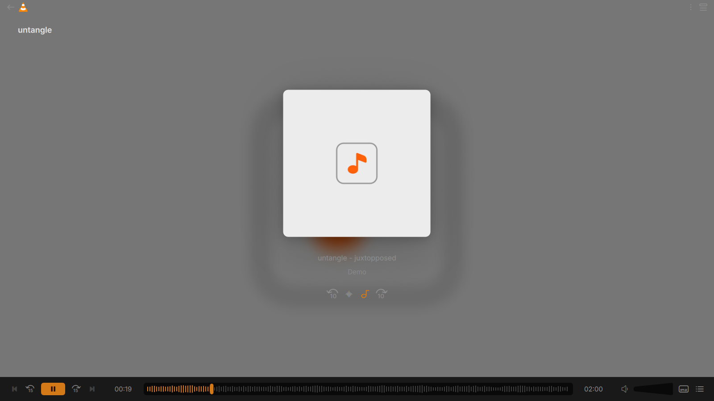
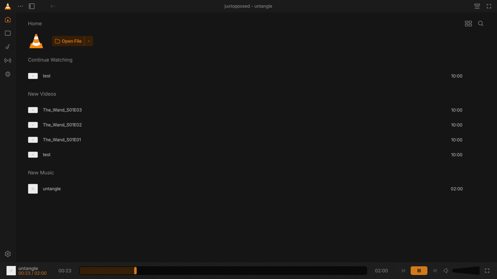
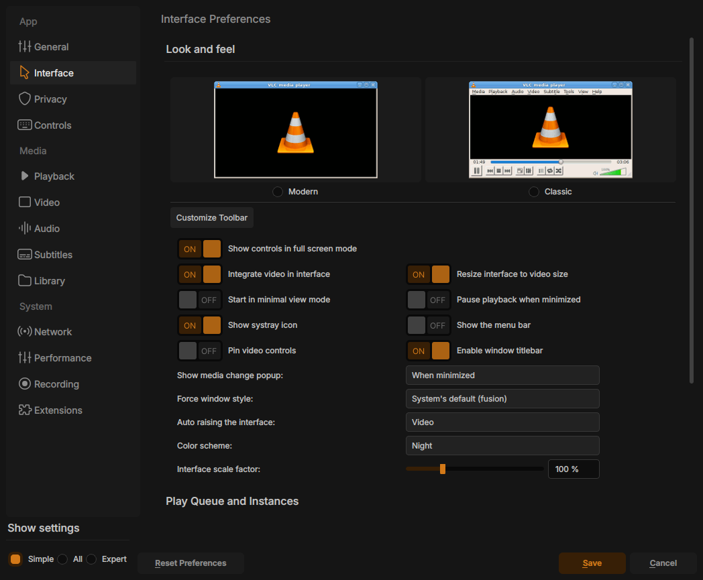
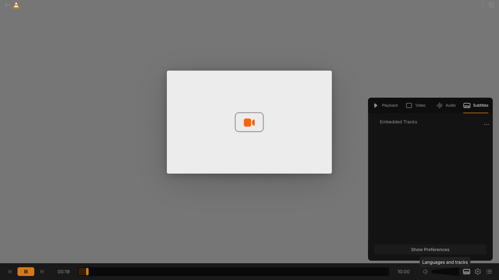
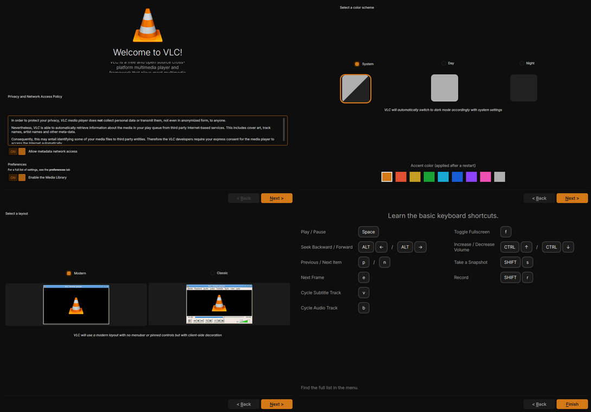
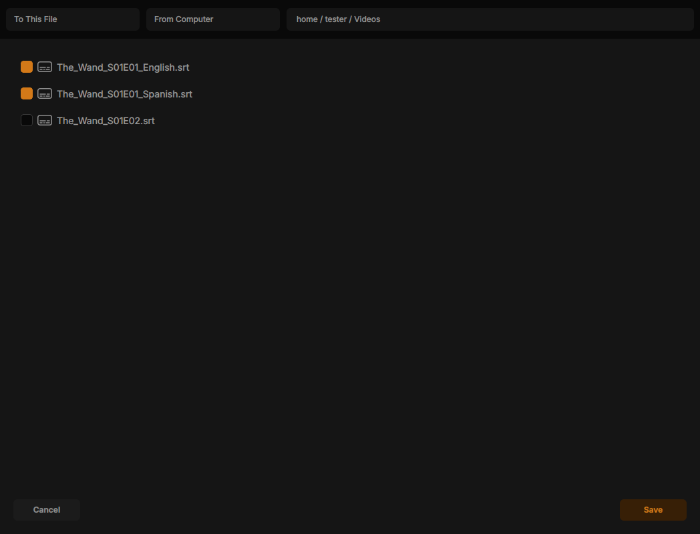
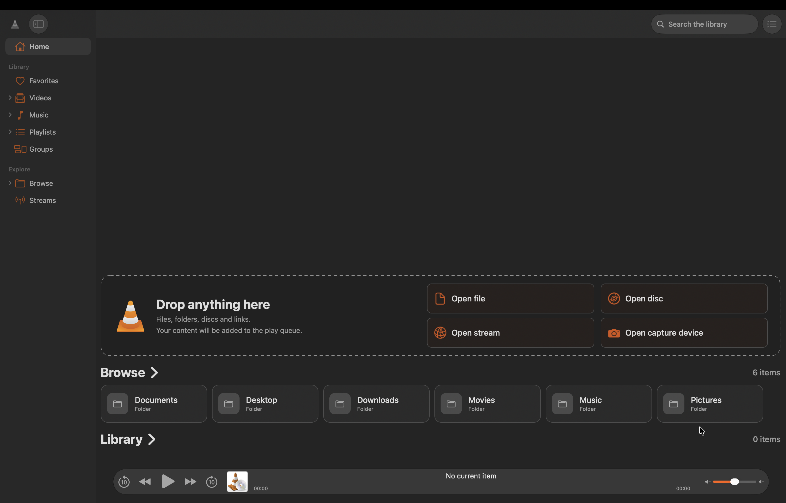
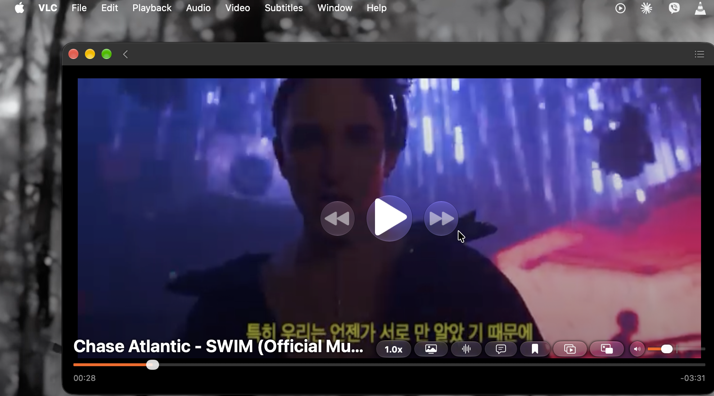
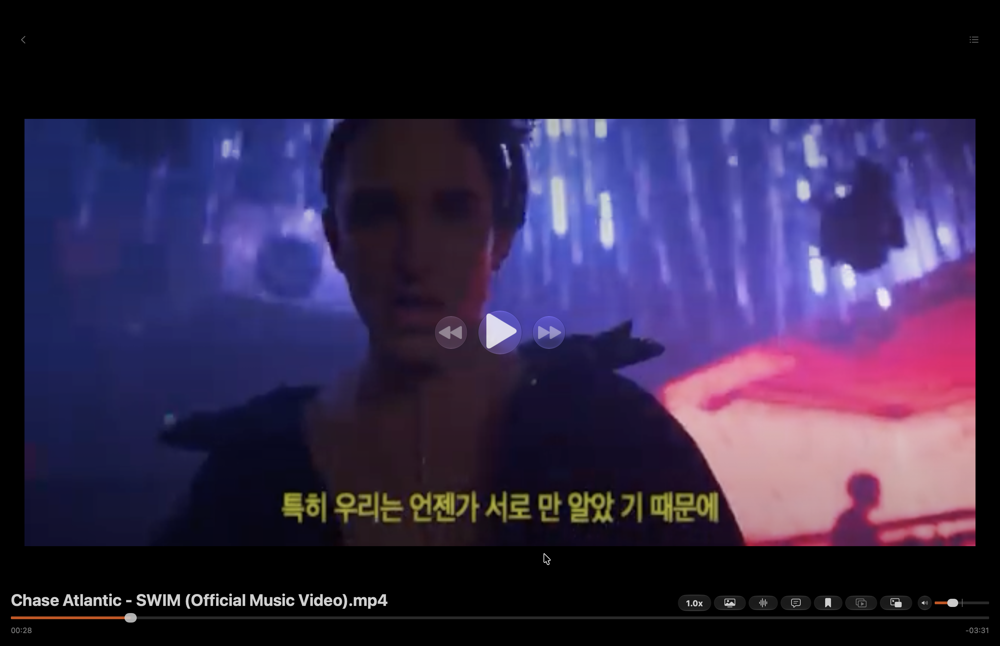

# VLC Remake

A redesigned interface for **[VLC media player](https://www.videolan.org/vlc/)**, implementing the
community **"VLC Redesign"** Figma design on top of VLC 4.0 (development version).
Interface redesigned by **[Abhishek Panthee](https://abhishekpanthee.com.np)**
([GitHub](https://github.com/abhishekpanthee)).

> **This is an unofficial, independent project.** It is not made, endorsed or supported by
> VideoLAN. VLC media player is developed by [VideoLAN](https://www.videolan.org) and the VLC
> authors; all the media playback, codecs, streaming and the rest of the player are their work.
> "VLC", "VideoLAN" and the VLC cone logo are trademarks of VideoLAN. Get the official VLC at
> <https://www.videolan.org>.



## Download

Download the file for your system from the **[latest release](https://github.com/abhishekpanthee/VLC-Remake/releases/latest)**:

| Your system | Download | |
|---|---|---|
| **Windows** 10 / 11 (64-bit) | [`vlc-remake-windows-x64-setup.exe`](https://github.com/abhishekpanthee/VLC-Remake/releases/latest/download/vlc-remake-windows-x64-setup.exe) | installer |
| **macOS** 12 or later, Apple Silicon (M1, M2, M3, M4, M5 and later) | [`vlc-remake-macos-arm64.dmg`](https://github.com/abhishekpanthee/VLC-Remake/releases/latest/download/vlc-remake-macos-arm64.dmg) | disk image |
| **macOS** 12 or later, Intel | [`vlc-remake-macos-x86_64.dmg`](https://github.com/abhishekpanthee/VLC-Remake/releases/latest/download/vlc-remake-macos-x86_64.dmg) | disk image, when available |
| **Ubuntu** 24.04, Linux Mint 22, Pop!_OS 24.04 | [`vlc-remake-linux-amd64.deb`](https://github.com/abhishekpanthee/VLC-Remake/releases/latest/download/vlc-remake-linux-amd64.deb) | package |
| **Other Linux** distributions (64-bit) | [`vlc-remake-linux-x86_64.AppImage`](https://github.com/abhishekpanthee/VLC-Remake/releases/latest/download/vlc-remake-linux-x86_64.AppImage) | single file, no install |

Not sure which Mac you have? Apple menu > **About This Mac**: "Chip: Apple M…" is Apple Silicon,
"Processor: Intel…" is Intel.

Other files in the release: `vlc-remake-macos-*.app.zip` (the macOS application without the disk
image), `vlc-remake-linux-x86_64.tar.gz` (a folder for Ubuntu 24.04, see `README-LINUX.txt` inside)
and `SHA256SUMS.txt` (checksums).

## Install

The packages are **not code signed** (signing costs money), so your system warns you the first time.

### Windows

1. Run `vlc-remake-windows-x64-setup.exe`.
2. If Windows shows **"Windows protected your PC"**, click **More info** > **Run anyway**.
3. Follow the installer.

It installs as VLC media player and replaces an installed VLC.

### macOS

1. Open the `.dmg` and **drag VLC onto the Applications folder** (opening VLC from the disk image
   does not install it).
2. The first time, **right click VLC** in Applications > **Open** > **Open**
   (or System Settings > Privacy & Security > **Open Anyway**).

macOS may ask for access to your Desktop, Documents or Downloads folders (the media library looks
for your videos and music there) and VLC may ask to control the Music app (to pause it while a video
plays): you can allow or deny, VLC works either way.

### Linux

**Ubuntu 24.04, Linux Mint 22, Pop!_OS 24.04:**

```sh
sudo apt install ./vlc-remake-linux-amd64.deb
```

Then open **VLC Remake** from the applications menu, or run `vlc-remake`. It installs to
`/opt/vlc-remake`, next to an installed VLC.

**Other distributions:**

```sh
chmod +x vlc-remake-linux-x86_64.AppImage
./vlc-remake-linux-x86_64.AppImage
```

If it does not start, install FUSE 2 (`libfuse2` on Debian/Ubuntu, `fuse-libs` on Fedora) or run it
with `--appimage-extract-and-run`.

## Updates

VLC Remake **does not update itself**: VLC's own updater would replace it with the official VLC.
New versions are published on the [releases page](https://github.com/abhishekpanthee/VLC-Remake/releases).
To be notified, click **Watch** > **Custom** > **Releases** at the top of this page.

## Screenshots

### Windows and Linux

| | |
|---|---|
|  |  |
|  |  |
|  |  |

### macOS

| | |
|---|---|
|  |  |
|  |  |

## What is redesigned

Only the user interface (`modules/gui/qt`) is changed:

- **Design tokens**: the redesign colors (dark and light themes), the Inter typeface, sizes and radii.
- **Icons**: the redesign icon set (123 glyphs), including new ones.
- **Player**: single row control bar with the inline seek bar, accent play button, wedge volume
  meter, 15 seconds jumps; music player with a rounded cover and a waveform style seek bar;
  floating resume prompt; mini player.
- **Title bar and navigation rail**, library lists and home sections.
- **Track panel**: audio, subtitles and video tracks, video settings (zoom, aspect ratio, crop...).
- **Settings**: sidebar with the 13 categories, toggles, redesigned keyboard shortcuts.
- **Dialogs**: Customize Player, Add Subtitles (new), Open Network Stream, New Playlist.
- **Onboarding**: welcome, theme and accent color, keyboard shortcuts.
- On macOS the redesigned (Qt) interface replaces VLC's native interface.

## Known limitations

- Based on VLC **4.0 development** code: expect the occasional bug of a development version.
- macOS: the Intel version is published when it has been built; macOS 12 or later is required.
- Linux: the `.deb` and `.tar.gz` are made for Ubuntu 24.04 and compatible distributions; use the
  AppImage elsewhere.

## Building

The build is the same as VLC's, see [INSTALL](INSTALL) and the
[VLC developer documentation](https://wiki.videolan.org/Developers_Corner).

- **Windows and Linux** packages are built by GitHub Actions
  ([`.github/workflows/build.yml`](.github/workflows/build.yml)): Actions > Build > Run workflow.
- **macOS** packages are built on a Mac (Xcode, `xcodebuild -downloadComponent MetalToolchain`,
  `brew install python@3.12`):

  ```sh
  extras/package/macosx/build-remake.sh          # Apple Silicon
  extras/package/macosx/build-remake.sh intel    # Intel
  ```

  The `.dmg` and `.app.zip` are written to `dist/`.

- **Linux** quick start (Qt >= 6.2, meson >= 1.10):

  ```sh
  meson setup build -Dqt=enabled
  ninja -C build
  ./build/bin/vlc
  ```

## Credits

- **VLC media player**: © VideoLAN and the VLC authors, see [AUTHORS](AUTHORS) and [THANKS](THANKS).
  This project is based on the VLC source code (upstream commit `d460ecd`), see [README-VLC.md](README-VLC.md).
- **Interface redesign**: [Abhishek Panthee](https://abhishekpanthee.com.np)
  ([github.com/abhishekpanthee](https://github.com/abhishekpanthee)).
- **Design**: the "VLC Redesign (Community)" file published on the Figma Community.
- **Typeface**: [Inter](https://rsms.me/inter/) by Rasmus Andersson, SIL Open Font License
  (`modules/gui/qt/pixmaps/fonts/LICENSE`).
- See [CREDITS.md](CREDITS.md) for details.

## License

Same as VLC: the VLC media player is licensed under the **GNU General Public License v2 or later**
([COPYING](COPYING)), libVLC under the **GNU Lesser General Public License v2.1 or later**
([COPYING.LIB](COPYING.LIB)). The changes made in this project are released under the same licenses.
